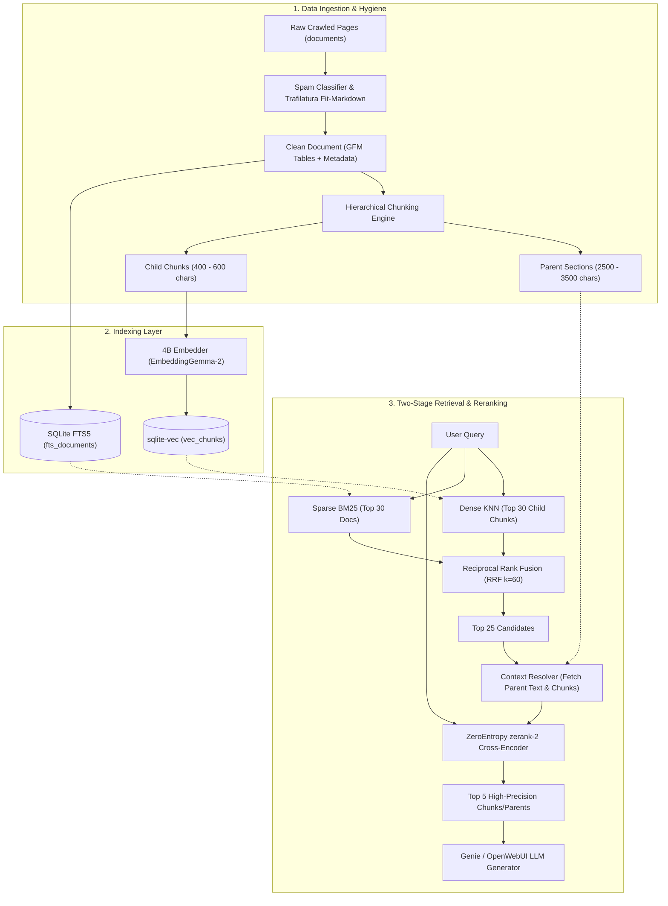

# Babel RAG Architecture & Optimization Plan: Messy Web Data, 4B Embedder & Cross-Encoder Reranking

## 1. Executive Summary

### 1.1 Context & Current Stack

Babel is a local-first, low-latency hybrid search and retrieval-augmented generation (RAG) system running on edge/server hardware (`xavier` ARM64 / `550w` GPU node). Its current technology stack consists of:

- **Storage & Vector Index**: SQLite with `sqlite-vec` (for dense vector search) and SQLite FTS5 BM25 (for sparse keyword search).
- **Dense Embedder**: 4B-class model (`unsloth/embeddinggemma-2-GGUF` / `Qwen-Embedding-4B` / `GTE-Qwen2`) hosted via an OpenAI-compatible endpoint.
- **Cross-Encoder Reranker**: ZeroEntropy's `zerank-2` (8k-token context cross-encoder).
- **Data Source**: 8,000+ web pages crawled from university domains (`ftu.edu.vn` and subdomains) stored in `documents` with 32,800+ text chunks in `document_chunks`.
- **Rank Fusion**: Reciprocal Rank Fusion (RRF with $k=60$) blending vector and keyword scores.

---

### 1.2 Key Audit Findings & Bottlenecks

1. **Reranker Context Starvation (Critical Bug)**:
   - In [`server/services/rerank.py`](file:///home/triph/PhuongBase/fusion/babel/server/services/rerank.py#L135-L138), candidate text sent to `zerank-2` evaluates:
     ```python
     documents = [
         str(hit.get("summary") or hit.get("rerank_text") or hit.get("snippet") or "")[:600]
         for hit in candidates
     ]
     ```
   - In `stash.db`, 8,008 documents have entries in `document_summaries`. Because `summary` comes first in the `or` chain, Python takes `hit.get("summary")` (which is only **180–270 characters**, a high-level 1-sentence synopsis) and **completely ignores** `rerank_text` (the 3 most relevant chunks totaling up to 8,000 characters gathered in [`server/services/embedding.py`](file:///home/triph/PhuongBase/fusion/babel/server/services/embedding.py#L213-L217)).
   - Even when falling back, hard slicing at `[:600]` characters (~100–120 words) starves `zerank-2`, which has an **8,192 token** capacity, wasting >95% of its contextual power.
   - In `_rerank_with_completion` ([`server/services/rerank.py#L55`](file:///home/triph/PhuongBase/fusion/babel/server/services/rerank.py#L55)), it is sliced even further to **250 characters**.
2. **Keyword Hits Missing Passage Content**:
   - In [`server/services/stash.py#L223-L288`](file:///home/triph/PhuongBase/fusion/babel/server/services/stash.py#L223-L288), `search_keyword()` returns only a 35-word SQLite FTS snippet and summary, leaving `rerank_text` completely absent. When a candidate originates from BM25, the reranker has no substantive text to evaluate.
3. **Data Quality & Infiltration**:
   - University crawling captured adversarial SEO spam (e.g. Casimba Casino, Casino777) injected into crawled subdomains, polluting both FTS and vector indexes.
   - Boilerplate headers, navbars, and cookie disclaimers remain embedded in the 4,000-character flat chunks.
4. **Naive Chunking Limitations**:
   - Flat sliding window chunking (4,000 characters with 400 overlap in [`processing/embeddings.py`](file:///home/triph/PhuongBase/fusion/babel/processing/embeddings.py)) cuts across tables, splits critical regulations, and causes semantic dilution for the 4B embedder.

---

## 2. Industry & Open Source State-of-the-Art (2024–2026)

When processing messy web scraped data with a large 4B-class embedder and an 8k cross-encoder, leading enterprise and OSS setups (Anthropic, Jina AI, Crawl4AI, Unstructured, Cohere) adhere to four core paradigms:

### 2.1 "Fit Markdown" & Ingestion Hygiene

- **Main Content Extraction**: Using libraries like `trafilatura` or Crawl4AI's `fit_markdown` algorithm to prune non-article DOM trees (headers, footers, navbars, sidebars) before text ever touches an embedding pipeline.
- **Tabular Preservation**: Preserving HTML `<table>` structures as GitHub-Flavored Markdown (GFM) tables or key-value representations, preventing columns and numbers from collapsing into unstructured text soup.
- **De-duplication & Spam Purging**: Running MinHash LSH and heuristic keyword/regex filters to discard SEO spam and duplicated cross-subdomain announcements.

### 2.2 Hierarchical "Small-to-Big" (Parent-Document) Retrieval

- **Child Chunks (150–300 tokens / 400–800 chars)**: Used exclusively for vector embedding and dense indexing. Micro-chunks prevent semantic dilution and keep embedding vectors focused on a single topic or fact.
- **Parent Sections (1,500–3,000 tokens / 3,000–6,000 chars)**: The enclosing semantic section or article body. Once child chunks score high in the first-stage hybrid search, the system resolves their parent context.
- **Reranker Scoring**: The cross-encoder is fed the child passage along with its immediate surrounding parent context, allowing it to perform full cross-attention over the exact facts.
- **LLM Prompt Expansion**: The top 3–5 surviving parent documents are deduplicated and supplied to the answer generation model.

### 2.3 Contextual Retrieval & Late Chunking

- **Contextual Embeddings (Anthropic 2024)**: Prepending 50–100 tokens of document-level situational context to each chunk prior to embedding (`[Tài liệu: Quy chế tuyển sinh ĐH 2024 - Trường ĐH Ngoại Thương | Mục: Điểm sàn]`), reducing top-20 retrieval failure by up to 49–67%.
- **Late Chunking (Jina AI 2024/2025)**: Passing full documents through long-context transformer encoders and applying mean-pooling across chunk spans *after* attention layers, allowing tokens in each chunk to retain global contextual awareness.

### 2.4 Matryoshka Representation Learning (MRL) & Instruction Alignment

- 4B-class embedders need strict instruction prefixes (e.g. `task: search result | query: ...` vs `title: ... | text: ...`).
- Where supported, MRL allows slicing high-dimensional embeddings (e.g., 2048/4096 dims down to 768/1024 dims) to reduce memory bandwidth and accelerate SQLite vector search by 3–4× without significant drop in recall.

---

## 3. Architecture Blueprint for Babel



---

## 4. Step-by-Step Implementation Roadmap

### Phase 1: Immediate Reranker Context & BM25 Fixes (Zero Schema Changes)

**Goal**: Stop starving `zerank-2` immediately using existing database contents and code structure.

1. **Fix `server/services/rerank.py` Payload Construction**:
   - Replace the short-circuiting logic in `rerank_hits()` ([lines 135–138](file:///home/triph/PhuongBase/fusion/babel/server/services/rerank.py#L135-L138)):
     - Prioritize `rerank_text` (chunk content) over `summary`.
     - Construct a high-signal candidate document combining `title`, `summary`, and `rerank_text`.
     - Increase the character budget from `600` to **3,500 characters** (~700 tokens), which easily fits into `zerank-2`'s 8k context window.
   - Update `_rerank_with_completion()` ([lines 53–56](file:///home/triph/PhuongBase/fusion/babel/server/services/rerank.py#L53-L56)) to allow up to 1,500 characters instead of 250 characters.
2. **Enrich BM25 Keyword Search in `server/services/stash.py`**:
   - In `search_keyword()` ([lines 236–252](file:///home/triph/PhuongBase/fusion/babel/server/services/stash.py#L236-L252)), join with `document_chunks` or `documents.markdown` to populate `rerank_text` for keyword hits.
   - When fusing vector and keyword hits in `search_hybrid()` ([lines 350–362](file:///home/triph/PhuongBase/fusion/babel/server/services/stash.py#L350-L362)), preserve and merge `rerank_text`.

---

### Phase 2: Database Hygiene & Spam Scrubbing

**Goal**: Cleanse existing index and prevent corrupted data from polluting retrieval.

1. **Scrubbing Script (`processing/clean_spam.py`)**:
   - Identify and purge non-FTU domain content and SEO spam (e.g. gambling keywords: `casino`, `baccarat`, `casimba`, `kèo nhà cái`, `đá gà`, `soi cầu`).
   - Remove corresponding rows from `documents`, `fts_documents`, `document_chunks`, `vec_chunks`, and `document_summaries`.
   - Execute `VACUUM` and SQLite FTS `optimize` on `stash.db`.
2. **Ingestion Gatekeeper**:
   - Add a pre-indexing validation function in `processing/cleanup.py` that verifies domain authority, filters blacklisted keywords, and extracts main content via `trafilatura` before database insertion.

---

### Phase 3: Hierarchical "Small-to-Big" Chunking & Context Expansion

**Goal**: Transition from flat 4,000-char chunks to parent-child chunking.

1. **Schema Extension in SQLite**:
   ```sql
   ALTER TABLE document_chunks ADD COLUMN parent_chunk_id INTEGER;
   ALTER TABLE document_chunks ADD COLUMN chunk_type TEXT DEFAULT 'child'; -- 'child' or 'parent'
   ```
2. **Chunk Generation**:
   - **Child Chunks**: 500 characters with 100 character overlap. Embedded via the 4B model into `vec_chunks`.
   - **Parent Chunks**: 3,000 characters (representing a full sub-section or article). Stored as reference text.
3. **Retrieval Pipeline**:
   - Hybrid search matches against sharp Child Chunks.
   - Reranker receives the Child Chunk + Parent Context slice.
   - Output formatter groups contiguous child chunks into parent blocks, preventing duplicate information in the LLM prompt.

---

### Phase 4: Contextual Retrieval Prepending

**Goal**: Implement Anthropic-style contextual enrichment for high-value university documents.

1. **Offline Context Generation**:
   - For official announcements, admissions tables, and regulations, use a lightweight, fast LLM to generate 1–2 sentence contextual prefixes:
     ```
     [Ngữ cảnh: Thông báo số 123/TB-ĐHNT ngày 15/06/2024 về Điểm sàn xét tuyển phương thức 3 và 4]
     ```
   - Store contextualized text directly in `document_chunks.chunk_text` for indexing by both FTS5 and `sqlite-vec`.

---

### Phase 5: Verification & Benchmark Evaluation

**Goal**: Quantify quality improvements using the FTU500 benchmark.

1. **Run Benchmark Collection**:
   ```bash
   uv run python bench/collect_and_batch_judge.py --concurrency 6 --submit
   ```
2. **Evaluate with LLM Judge**:
   - Model: `deepseek-ai/DeepSeek-V4-Flash-0731` on DeepInfra.
   - Continuous float multi-factor scoring: `factual_accuracy`, `groundedness`, `completeness`, `adherence` -> `final_score`.
3. **Target Metrics**:
   - `factual_accuracy` > 0.85 (up from ~0.65 on detailed factual queries).
   - Zero hallucinations caused by SEO spam or truncated admission cutoff tables.

---

## 5. File Modification Checklist

| File                                                                                                               | Proposed Change                                                                                      |        Priority        |
| :----------------------------------------------------------------------------------------------------------------- | :--------------------------------------------------------------------------------------------------- | :---------------------: |
| [`server/services/rerank.py`](file:///home/triph/PhuongBase/fusion/babel/server/services/rerank.py)               | Fix candidate text construction, prioritize `rerank_text`, expand truncation limit to 3,500 chars. | **P0 (Critical)** |
| [`server/services/stash.py`](file:///home/triph/PhuongBase/fusion/babel/server/services/stash.py)                 | Ensure BM25 search populates `rerank_text`; merge passage text in RRF fusion.                      | **P0 (Critical)** |
| [`processing/clean_spam.py`](file:///home/triph/PhuongBase/fusion/babel/processing/)                              | Create script to purge SEO/casino spam and orphaned chunks from `stash.db`.                        |   **P1 (High)**   |
| [`processing/cleanup.py`](file:///home/triph/PhuongBase/fusion/babel/processing/cleanup.py)                       | Integrate `trafilatura` for clean main-text extraction and GFM table preservation.                 |   **P1 (High)**   |
| [`processing/embeddings.py`](file:///home/triph/PhuongBase/fusion/babel/processing/embeddings.py)                 | Implement hierarchical child-parent chunking and contextual prefixing.                               |  **P2 (Medium)**  |
| [`bench/collect_and_batch_judge.py`](file:///home/triph/PhuongBase/fusion/babel/bench/collect_and_batch_judge.py) | Benchmark end-to-end response accuracy before and after optimization.                                |  **P2 (Medium)**  |
