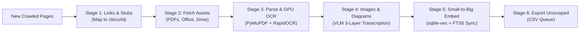

# Babel

Hybrid-searchable knowledge base system using **USearch (HNSW)** and `sqlite-vec` for sub-millisecond vector retrieval, SQLite FTS5 for BM25 keyword search, and ZeroEntropy's `zerank-2` for reranking.

---

## Repository Structure

```
babel/
├── processing/                 # Offline / ETL data processing pipelines
│   ├── pipeline.py             # ★ Unified Periodic Processing Orchestrator (End-to-End)
│   ├── build_usearch_index.py  # USearch HNSW vector index builder & benchmark tool
│   ├── cleanup.py              # HTML to clean Markdown converter & boilerplate purging
│   ├── parse_all_documents.py  # Unified multi-format document parser & GPU RapidOCR
│   ├── fetch_pdfs.py           # Digital & scanned PDF downloader
│   ├── fetch_other_files.py    # Office docs, spreadsheets & Google Drive/Docs downloader
│   ├── process_embedded_images.py # Candidate diagram detection & Qwen3.6-35B-A3B VLM transcriber
│   ├── finalize_stage2_injection.py # Template cleaner & in-place 3-layer diagram injector
│   ├── embeddings.py           # Hierarchical Small-to-Big chunking & vector embedder
│   ├── summarize.py            # Date extraction, LLM summarizer & summary vectors
│   └── unscraped_links.csv     # 9.5k unique candidate unscraped URLs for crawler queues
├── server/                     # Production server application package
│   ├── app.py                  # FastAPI app factory (create_app) & instance
│   ├── config.py               # Centralized settings and .env loader
│   ├── db.py                   # SQLite persistent connection pool with sqlite-vec
│   ├── models/                 # Pydantic schemas, ORM models, and text cleaners
│   │   ├── orm.py              # SQLAlchemy Document / StoredCrawlResult models
│   │   ├── schemas.py          # SearchRequest, SingleSearchResult, DocumentDetailResponse
│   │   └── text.py             # Normal text cleaner (strips markdown headers/links/images)
│   ├── routes/                 # API endpoint routers
│   │   ├── docs.py             # GET /docs/{doc_id} & /docs/{doc_id}/
│   │   ├── motd.py             # GET / (MOTD router)
│   │   └── search.py           # GET & POST /search & /api/search
│   └── services/               # Core business & search services
│       ├── embedding.py        # Runtime USearch (mmap) & fallback query vector scoring
│       ├── rerank.py           # ZeroEntropy zerank-2 candidate reranking
│       └── stash.py            # Unified Stash repository & search orchestrator
├── stash.db                    # Core SQLite store (documents, metadata, FTS5 index)
├── stash.usearch               # Memory-mapped USearch HNSW vector index (439k vectors, ~0.06ms)
│       ├── rerank.py           # ZeroEntropy zerank-2 candidate reranking
│       └── stash.py            # Unified Stash repository & search orchestrator
├── Containerfile               # Debian slim container specification
├── Dockerfile                  # Symlink to Containerfile
├── main.py                     # Server entrypoint (`uvicorn main:app`)
├── models.py                   # Backward-compatible facade for models
├── stash.py                    # Backward-compatible facade for Stash
├── embed_stash.py              # Backward-compatible facade for embeddings
├── rerank_stash.py             # Backward-compatible facade for reranker
├── process_cleanup.py          # Backward-compatible facade for cleanup CLI
└── summarize_stash.py          # Backward-compatible facade for summarizer CLI
```

---

## Running the Server

Start the API server locally with:

```sh
uvicorn main:app --host 127.0.0.1 --port 8000
```

### Endpoints

- **`GET /search?q={query}&limit=10&hybrid_blend=0.5&format=json|text`**
  Hybrid semantic vector (sqlite-vec) + keyword (FTS5 BM25) search with `zerank-2` reranking.
  Supports `format=text` or header `Accept: text/plain` for token-efficient RAG LLM context ingestion.
- **`POST /search`**
  Same search functionality with a JSON request body:
  ```json
  {"query": "học bổng", "limit": 10, "hybrid_blend": 0.5, "format": "json"}
  ```
- **`GET /docs/{doc_id}/?format=json|text&clean=true|false`**
  Fetch full document content and metadata by document ID.
- **`POST /docs/fetch`** (aliases: `/api/fetch`, `/docs/batch`)
  Batch fetch multiple documents in a single request:
  ```json
  {"doc_ids": [1525, 1102], "format": "text", "clean": true}
  ```
  Also available via `GET /docs/fetch?ids=1525,1102&format=text`.
- **`GET /`**
  Random Message of the Day (MOTD).

---

## Periodic Processing Pipeline Tutorial

The knowledge base pipeline in `processing/pipeline.py` provides a unified, fully idempotent periodic orchestrator. Whenever new pages are crawled or added to `stash.db`, the pipeline processes only the newly added delta without re-doing or re-embedding existing documents.



### 1. Quickstart & Monitoring

#### Check Knowledge Base Status Dashboard
Inspect live counts of indexed documents, vectors, stubs, and any pending delta work:

```sh
python -m processing.pipeline --status
```

*Example Output:*
```text
=================================================================
         BABEL KNOWLEDGE BASE PIPELINE STATUS DASHBOARD
=================================================================
Total Documents in DB         : 10,303
Documents Chunked & Embedded  : 9,420 / 10,303
Total Parent Chunks           : 65,551
Total Child Vectors Indexed   : 439,313 (vec_chunks: 439,313)
FTS5 Search Indexed Documents : 10,054
-----------------------------------------------------------------
Document Stubs Breakdown:
  • extracted   : 1,414
  • failed      : 80
  • unavailable : 562
-----------------------------------------------------------------
Pending Pipeline Work (Delta):
  • Pending Stubs to Fetch     : 0
  • Downloaded Files to Parse  : 0
  • Documents to Chunk & Embed : 0
=================================================================
```

#### Run Entire Periodic Pipeline (End-to-End)
Executes all stages in sequence on any new delta:

```sh
python -m processing.pipeline --all
```

---

### 2. Step-by-Step Stage Execution

You can also trigger individual stages independently:

#### Stage 1: Link Canonicalization & External Document Stubbing
Scans article Markdown text, rewrites links pointing to existing documents to `/docs/{target_id}`, identifies external file attachments (PDFs, DOCX, XLSX, Google Drive/Docs/Sheets), creates stub records, and rewrites their links to `/docs/{stub_id}`:

```sh
python -m processing.pipeline --links
```
*Note: Social media links (`facebook.com`, `youtube.com`, `tiktok.com`, `zalo.me`, etc.) are automatically preserved as external URLs.*

#### Stage 2: Fetch Pending Document Assets
Downloads files for any stubs marked `status = 'pending'`. Supports direct PDFs/Word/Excel, Google Drive direct downloads (`https://drive.google.com/uc?id={id}&export=download`), Google Docs export (`/export?format=docx`), Google Sheets export (`/export?format=xlsx`), and Dropbox:

```sh
python -m processing.pipeline --fetch
```

#### Stage 3: Multi-Format Document Parsing & GPU OCR
Parses downloaded document assets into clean Markdown. Digitally readable PDFs are extracted with PyMuPDF, while scanned documents are accelerated with **RapidOCR on NVIDIA GPU** (cuDNN v12). Also parses Word DOCX/DOC, Excel spreadsheets (as Markdown tables), and extracts ZIP archives:

```sh
python -m processing.pipeline --parse --concurrency-parse 4
```

#### Stage 4: Image Template Filtering & Diagram VLM Transcription
1. Cleans up repetitive decorative template markers (national flags, university logos, social icons, UI banners) into clean descriptive text (e.g. `[Cờ Việt Nam]`, `[Biểu trưng FTU]`) or strips them out.
2. Identifies candidate organizational charts, flowcharts, and diagrams in `documents.media`.
3. Sends candidate diagrams to `Qwen3.6-35B-A3B` VLM (`https://swarm.ftds.online`) to transcribe into a 3-layer representation:
   - **Layer 1**: Mermaid flowchart (`flowchart TD`)
   - **Layer 2**: Indented hierarchical text tree
   - **Layer 3**: Natural language prose summary
4. Injects the transcription directly into the Markdown document at the image's original position:

```sh
python -m processing.pipeline --images
```

#### Stage 5: Hierarchical Chunking & Vector Embedding
Takes all new or updated documents and indexes them into `sqlite-vec`:
- **Parent Chunks**: Macro-sections (~3,000 characters, 300 overlap) stored in `document_chunks(chunk_type='parent')`.
- **Child Chunks**: Micro-passages (~500 characters, 100 overlap) prepended with document context `[Tài liệu: ... | Ngày: ...]` linked to `parent_chunk_id`.
- **Vector Space**: Generates 768-dim float32 vectors via FalcoLabs gateway (`https://550w.falcolabs.org/v1/embeddings`, model: `unsloth/embeddinggemma-2-GGUF`) with high concurrency (concurrency=16) and indexes them into `vec_chunks`.
- **Full-Text Search Sync**: Automatically synchronizes document bodies into SQLite FTS5 (`fts_documents`) with diacritic-insensitive Vietnamese tokenization (`unicode61 remove_diacritics 2`):

```sh
python -m processing.pipeline --embed --concurrency-embed 16
```

#### Stage 6: Export Unscraped Links Queue
Scans all article Markdown and crawler link metadata to compile all discovered FTU URLs that have not yet been crawled into `documents`. Exports them sorted by frequency to CSV for subsequent crawler runs:

```sh
python -m processing.pipeline --export-unscraped
```
*Outputs are saved to `unscraped_ftu_links.csv` and `processing/unscraped_links.csv`.*

---

### 3. Idempotency & Delta Processing Guarantees

Every stage in `processing/pipeline.py` is strictly idempotent:
- **Zero Duplicate Chunks/Vectors**: Documents that already have chunk records in `document_chunks` are excluded. Vectors already in `vec_chunks` are never recomputed.
- **Zero Redundant Downloads**: Files already present on disk in `downloads/` with non-zero size are immediately marked downloaded and skipped.
- **Zero Redundant VLM Calls**: Diagram transcriptions are cached in `downloads/charts/`. Once injected into Markdown (`<!-- DIAGRAM_START: ... -->`), documents are skipped.
- **Safe Periodic Execution**: Running `python -m processing.pipeline --all` repeatedly when no new documents have been crawled takes ~2 seconds and exits without making unnecessary network calls.

---

### 4. Periodic Automation (Cron Setup)

To run the pipeline automatically on a recurring schedule (e.g., daily at 2:00 AM):

```sh
# Open crontab editor
crontab -e

# Add entry for daily processing run:
0 2 * * * cd /home/triph/PhuongBase/fusion/babel && .venv/bin/python -m processing.pipeline --all >> logs/pipeline_cron.log 2>&1
```

---

## Legacy / Individual Scripts

Individual processing scripts are located in `processing/` for granular debugging:

- `processing/cleanup.py`: Raw HTML to Markdown converter.
- `processing/summarize.py`: Date extraction and LLM summarization.
- `processing/embeddings.py`: Underlying hierarchical chunking & embedding engine.
- `processing/parse_all_documents.py`: Document parsing & RapidOCR GPU engine.
- `processing/fetch_pdfs.py` & `processing/fetch_other_files.py`: Low-level scrapers.

---

## Container Deployment

### Using Docker Compose / Podman Compose (Recommended)

Start the entire stack with a single command:

```sh
docker compose up -d
# or with podman:
podman compose up -d
```

This reads `.env`, mounts `stash.db` into `/app/data/stash.db`, and exposes port `8000`.

### Manual Container Run

```sh
# Pull the pre-built image
docker pull ghcr.io/spikevn/ftu-babel:latest

# Run with mounted database files
docker run -d \
  --name babel \
  -p 8000:8000 \
  -v ./stash.db:/app/data/stash.db:rw \
  -v ./stash.db-wal:/app/data/stash.db-wal:rw \
  -v ./stash.db-shm:/app/data/stash.db-shm:rw \
  -v ./stash.usearch:/app/data/stash.usearch:ro \
  --env-file .env \
  ghcr.io/spikevn/ftu-babel:latest
```

---

## Model & Search Configuration

Configure upstream endpoints and API keys in `.env`:

```sh
# MOSS Gateway Endpoints & API Key
MOSS_API_KEY="your_moss_api_key"
MOSS_EMBEDDING_ENDPOINT="https://550w.falcolabs.org/v1/"
MOSS_RERANKING_ENDPOINT="https://550w.falcolabs.org/v1/"

# (Optional) Backwards compatibility aliases
# FTULABS_API_KEY="your_moss_api_key"
# FTULABS_API_ENDPOINT="https://550w.falcolabs.org/v1/"
```

Search retrieves top vector and keyword candidates, fuses them using Reciprocal Rank Fusion (RRF), then reranks them with the reranker model (zerank-2 / MOSS).

Optional overrides:
- `EMBED_URL`: overrides embedding API endpoint (e.g. `https://550w.falcolabs.org/v1/embeddings`)
- `EMBED_API_KEY`: overrides `MOSS_API_KEY` for embedding
- `ZEROENTROPY_API_KEY`: overrides `MOSS_API_KEY` for reranking
- `ZEROENTROPY_BASE_URL`: overrides `MOSS_RERANKING_ENDPOINT` for reranking
- `ZERANK_MODEL`: reranker model name (default: `zerank-2`)
- `ZERANK_CANDIDATE_K`: candidate count before reranking (default: `30`)
- `ZERANK_TIMEOUT`: request timeout in seconds (default: `45`)
